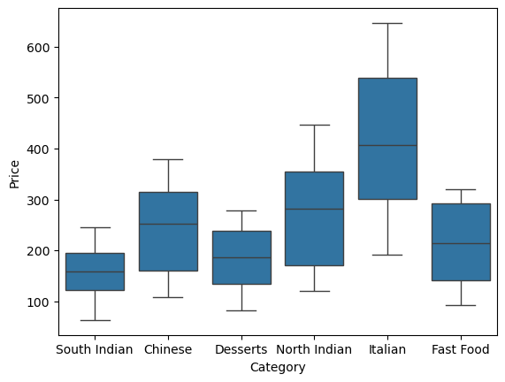
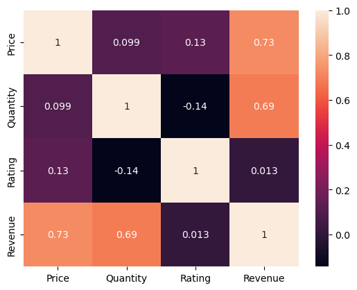
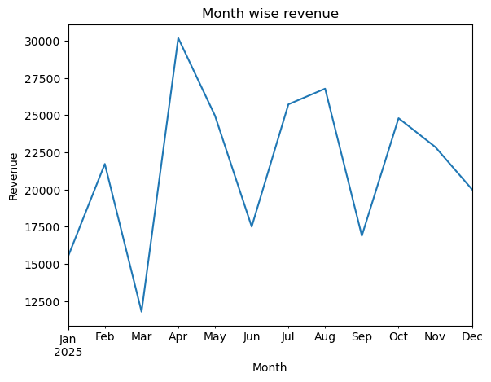
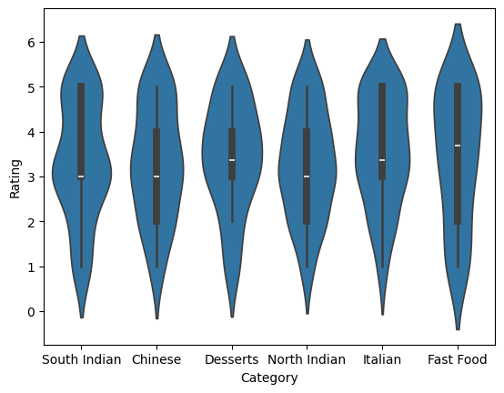

# TastyBite Food Delivery Analysis 🍕📊

## 📖 Project Overview & Business Case
TastyBite is a food delivery service looking to optimize operations, increase revenue, and improve customer satisfaction. This project analyzes customer order history to uncover key purchasing patterns, popular cuisines, payment preferences, and long-term revenue trends to guide business decisions.

## 🛠️ Technologies Used
* **Python**: Core programming language.
* **Pandas**: Data cleaning and analysis.
* **Matplotlib & Seaborn**: Data visualization and statistical charts.

## 💡 Key Business Insights
* **Top-Performing Cuisine:** North Indian cuisine generated the highest total revenue and order volume.
* **Payment Preferences:** Digital payments (UPI/Cards) account for over 60% of total transactions.
* **Revenue Trends:** Monthly sales showed peak demand during weekend order windows.

## 🖼️ Visual Highlights

### 1. Price Distribution Across Categories (Box Plot)
Displays median price points, interquartile ranges, and pricing outliers across menu categories.

### 2. Key Metrics Correlation Heatmap
Measures relationship strengths between order volume, price points, ratings, and total revenue.

### 3. Monthly Revenue Trend
Tracks monthly total revenue over time to identify seasonal peaks and overall business growth.

### 4. Rating Distribution Density (Violin Plot)
Analyzes customer satisfaction rating patterns and distributions across different food categories.

